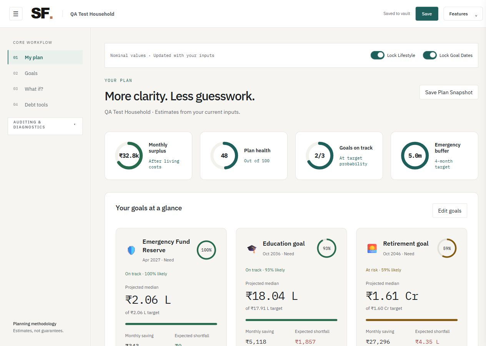
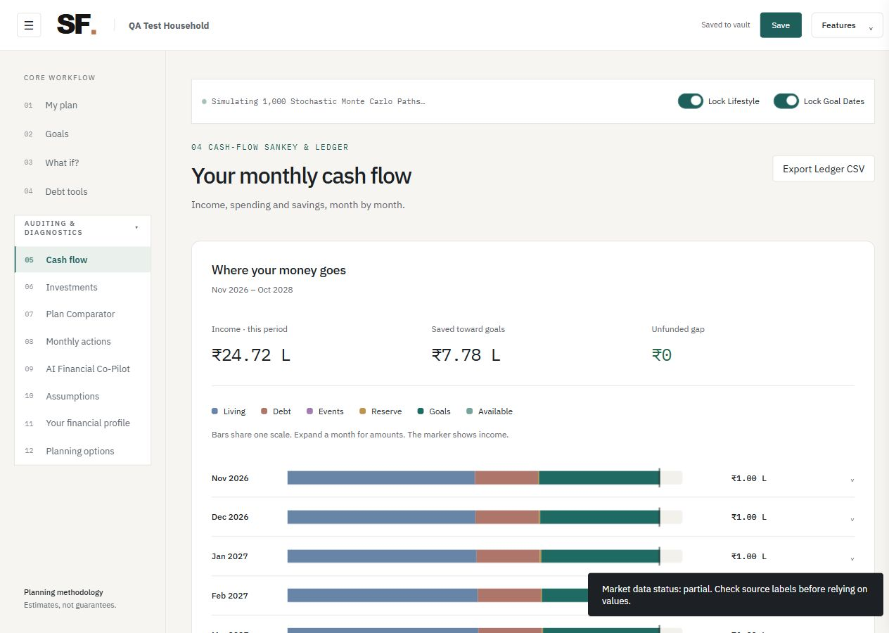
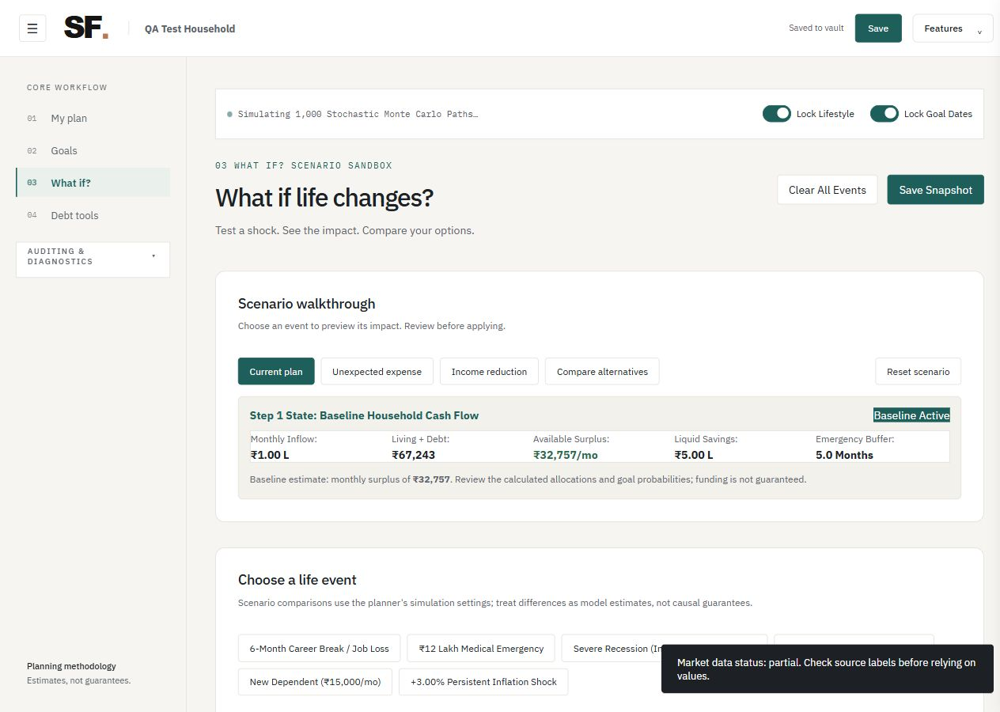

# GoalPulse - INFINITE LOOP

INFINITE LOOP / SRUJANA 2026 / 01

GoalPulse


## GoalPulse


Multi-goal financial planning
under uncertainty

Detailed project report | Final submission | 26 October 2026

- **TEAM**: INFINITE LOOP

- **THEME**: Finance

- **OFFICIAL SELECTION**: F-02 - Multi-Goal Financial Planning Under Uncertainty

- **REPOSITORY**: <link href="https://github.com/hemanth991/INFINITE_LOOP" color="#236c63">https://github.com/hemanth991/INFINITE_LOOP</link>

- **TEAM MEMBERS**: HEMANTH RAJ BV<br/>PANKAJ R GOWDA<br/>SJ RUCHITH GOWDA<br/>GIRIDHAR N

THE DECISION WE MAKE CLEARER

What can a household fund, what breaks when life changes, and which adjustment fits its priorities? GoalPulse connects those questions in one monthly financial model.

Submission scope: working local prototype, verified engineering changes, reproducible synthetic examples and explicit limitations. This report does not claim independent financial validation, guaranteed returns, successful public deployment or completed live AI inference.

INFINITE LOOP / SRUJANA 2026 / 02

Executive summary and evidence map


## Executive summary and evidence map


GoalPulse is a browser-based planning simulator for households balancing education, retirement, purchases, loan repayment and emergency protection. Rather than treating each goal as an isolated SIP calculation, it allocates a shared stream of income and existing capital through a month-by-month ledger. Users can inspect uncertainty, introduce shocks, preserve constraints and compare candidate adjustments.

A vanilla JavaScript interface and financial engine run locally in the browser. A Web Worker handles computationally expensive simulation and recovery jobs. A Python FastAPI service provides account authentication, private SQLite persistence, market requests and optional AI explanations. The AI explains a structured engine snapshot; it is not the numerical engine.

- **CORE PROOF**: The monthly cash-accounting invariant exposes missing funding rather than manufacturing spendable cash. Extra debt principal is capped by actual surplus.

- **UNCERTAINTY**: 1,000 seeded paths, configured asset correlations and category-specific inflation; results remain conditional on model assumptions.

- **RECOVERY**: Supported cash-yield/fee comparisons precede a bounded grid search over eligible changes. A shortlist is simulated; Pareto filtering compares tested trade-offs.

- **LATEST TEST RUN**: 82 JavaScript tests passed; 31 Python backend tests passed. Some UI checks inspect source patterns and are not browser interaction tests.

- **REPRODUCIBLE RESULT**: A synthetic six-month income interruption produced an unfunded gap of INR 124,428.41 despite long-horizon goals remaining modelled as funded.

- **EXTERNAL LIMIT**: Gemini returned HTTP 503 during live probes. OpenAI reported no API credits. Successful cloud-generated advice is not demonstrated.

- **PUBLICATION STATUS**: The existing team repository was reachable anonymously and initially contained only README.md. A clean, secret-excluding source/report package is prepared separately; publication must be verified after upload.

INFINITE LOOP / SRUJANA 2026 / 03

Problem understanding


## Problem understanding


Selected problem and interpretation

The team selected Finance problem F-02: Multi-Goal Financial Planning Under Uncertainty. The problem requires users to understand how simultaneous goals respond to income, expenses, savings, liabilities, inflation, unexpected events and limited resources. The supplied internal blueprint informed design; this report does not reproduce it as if it were the official organizer brief.

Target users and pain points

• <b>Households:</b> education, retirement and discretionary goals compete for one salary and the same savings. Separate calculators can overcommit both.

• <b>Borrowers:</b> an attractive prepayment illustration can become unaffordable when living costs, shocks and other goals are included.

• <b>Financial-literacy learners and adviser pilots:</b> users need understandable consequences, inspectable assumptions and comparisons between realistic choices.

Specific needs addressed

Users need to distinguish cash-flow feasibility from final wealth, identify an early deficit, avoid counting earmarked money twice, respect non-negotiable commitments, evaluate uncertainty and choose among money/time/scope trade-offs. The interface therefore combines goal cards, savings partitions, uncertainty bands, monthly bars, locked constraints and snapshots.

Assumptions and boundaries

Inputs are user-supplied and not verified against bank accounts. Salary growth, returns, correlations, inflation, tax and insurance settings are configurable model assumptions. The default plan starts in October 2026; results depend on the exact saved inputs and display units. The application is a simulator, not a trading service or a guarantee of goal success.

WHY THE PROBLEM MATTERS

A plan can show sufficient retirement wealth while failing to pay a near-term EMI after an income interruption. Seeing that gap early can support a reserve or spending decision before the household commits to an unrealistic plan.

INFINITE LOOP / SRUJANA 2026 / 04

Proposed solution and user journey


## Proposed solution and user journey


- **1 / ENTER**: Register a disposable/demo household or sign in. Enter income, spending, savings, reserve, loans, insurance assumptions and goals.

- **2 / VALIDATE**: Reject invalid values and capital overallocations. Keep a goal draft separate from the active plan; explicitly fit excess earmarks if requested.

- **3 / UNDERSTAND**: Read surplus, reserve runway, goal probability/shortfall, savings partition and a projection interval. Expand calculation details for exact inputs.

- **4 / STRESS**: Introduce income, medical, market, rate, dependent-cost or inflation events. Inspect reserve use, cash deficits, goals and monthly allocation.

- **5 / COMPARE**: Preserve lifestyle/date constraints. Explore debt changes or recovery candidates; compare frozen snapshots before applying a choice.

- **6 / COMMIT**: Apply a draft or debt setting explicitly. Save to the vault with confirmation; export JSON/CSV for an independent copy.

- **7 / EXPLAIN**: Optionally connect Gemini/OpenAI to explain the current snapshot. A minimal connectivity probe sends no financial context. Without service access, use the local summary.

What changes for the user

A single interactive journey connects choices that are normally scattered across a loan calculator, a SIP calculator, a budget sheet and a chatbot. The user sees the consequences of an income shock on liquidity and funding, then compares eligible interventions instead of receiving a generic instruction to save more.

Meaningful interface refinement

The final interface uses a compact Features disclosure in the header, shorter copy, greater spacing, goal success rings, savings/goal allocation bars and a monthly cash-flow infographic. Details and the exact audit ledger remain available through disclosures. This reduces repeated text while preserving inspectability.

INFINITE LOOP / SRUJANA 2026 / 05

Architecture, stack and component boundaries


## Architecture, stack and component boundaries


Figure 1. Logical system architecture. Calculations are browser-side JavaScript; the backend handles persistence and integrations. External services are optional to the core planner.

- **FRONTEND**: Vanilla HTML/CSS and ECMAScript modules; no React framework or frontend compilation pipeline is required. dist/app.js binds routes and interactions.

- **CALCULATION**: dist/engine/core.js, planning.js and advanced.js. dist/engine/worker.js executes simulation/recovery and caches repeated requests.

- **BACKEND**: Python 3.11+ with FastAPI 0.162.0, Uvicorn 0.54.0 and HTTPX 0.28.1. run_backend.py serves the same-origin app and API.

- **PERSISTENCE**: Python sqlite3, private filesystem database, transactions and WAL journal mode. Browser local storage is a device copy, not the canonical confirmation of a server save.

- **VERIFICATION**: Node built-in test runner; pytest 9.1.1 and AnyIO 4.15.1. Build checks syntax and produces route entry HTML; it does not simulate browser clicks.

INFINITE LOOP / SRUJANA 2026 / 06

Database design and data flow


## Database design and data flow


- **families**: <b>id TEXT PRIMARY KEY</b><br/><b>payload TEXT NOT NULL</b><br/>JSON document containing account hash metadata, household plan, snapshots and update information.

- **sessions**: <b>token TEXT PRIMARY KEY</b><br/><b>family TEXT NOT NULL</b><br/><b>expires REAL NOT NULL</b><br/>The token column stores a SHA-256 token digest. family identifies the household; expires enforces the session lifetime.

Save and restoration flow

The caller sends a bearer session token. The backend hashes it, finds a non-expired session, checks household ownership, validates financial inputs and writes the plan/snapshots transactionally. Login/session restoration returns the saved household state. Passwords are salted scrypt hashes; original passwords are not returned in account responses. Logout revokes the session. Sessions expire after 12 hours and are durable across server restarts.

Transactions and final concurrency repair

storage.save_family uses BEGIN IMMEDIATE, parameterized SQL and an atomic update. A final repair serializes schema initialization and avoids changing an already-WAL database journal mode during concurrent first requests. A new eight-thread fresh-database test verifies one successful insert and seven unique-key rejections, with no storage failure in that test. This is focused validation, not evidence of high-load or multi-host safety.

Why document payloads inside SQLite?

Goals, loans and shocks are variable nested collections. A JSON household document simplifies prototype saves while SQLite supplies transaction boundaries and uniqueness. The compromise is limited relational querying, fewer field-level constraints and a migration problem as the schema evolves. The sessions table is separate because revocation and expiry are independent of the plan document.

PRIVATE STORAGE

The default database is var/families.sqlite3, outside public dist/. Private legacy backups, var/, var-test/, .env files and local API credentials are excluded from the submission source package. Encryption at rest and production backup operations are not established by this build.

INFINITE LOOP / SRUJANA 2026 / 07

Core algorithms and accounting


## Core algorithms and accounting


Monthly simulation pipeline

Validate inputs → initialize earmarked wealth and reserves → iterate months → apply income growth, inflation and shocks → service contractual debt → cap extra principal by surplus → draw/refill reserve → allocate to eligible goals → update wealth and cash → assert the accounting invariant → evaluate goal horizons.

Numerical building blocks

- **CAPITAL FIT**: capitalSummary separates emergency reserve, goal earmarks and available savings. fitEarmarks provides an explicit proportional repair using paise-level allocation without silently mutating the source draft.

- **DEBT**: emi and amortize build contractual schedules. Recurring extra principal uses real surplus; lender-specific prepayment fees are not fully modelled. Refinancing is a separate estimate, not an automatic rate switch.

- **TARGETS**: Required savings and future goal costs use current capital, horizon and category inflation. Defaults for inflation and asset statistics are editable assumptions, not authenticated market predictions.

- **ALLOCATION**: Need/Want/Wish priorities, goal weights, horizon allocation and constraints determine contributions from a shared budget. Expiring EMIs can release cash in later months through that same ledger.

Conservation invariant

```
income + reserveDraw + unfunded
  = essentials + discretionary + debtPayment
  + shockCost + reserveRefill + goalAllocation
  + unallocatedCash
```

The engine checks the equivalent residual each month and raises an error above an absolute INR 0.01 tolerance. An unfunded gap is explicitly reported missing money, not available income. Conservation is a bookkeeping guarantee within the implementation; it does not prove that the assumptions match the real world.

INFINITE LOOP / SRUJANA 2026 / 08

Uncertainty, recovery and differentiation


## Uncertainty, recovery and differentiation


Deterministic ledger plus Monte Carlo

evaluate produces an inspectable deterministic monthly plan. simulate runs 1,000 paths by default, seeded from configuration (seed 42), combines random asset changes using Cholesky decomposition of the configured correlation matrix, and derives goal success estimates and quantiles. Inflation and event exposure change costs and resources over time. A seeded run is reproducible; a displayed probability is conditional on assumptions, not an empirically calibrated promise.

Constraint-aware recovery

Recovery first compares supported cash-yield and direct-fee assumptions. The shared-buffer statistic does not inject extra money. A finite grid then considers permitted date delays, discretionary trims, goal scope and savings step-ups. Lifestyle locks, date locks and hard goals restrict eligible changes. Candidates are ranked deterministically, up to a shortlist are re-simulated, and Pareto filtering retains non-dominated tested options across money, delay and effort. An additional-income search estimates a deterministic lower bound; it is not a salary guarantee.

What is distinctive in this implementation

• <b>One rupee, one budget:</b> earmarks, reserves, debt payments and goals interact through actual shared resources.

• <b>Liquidity versus distant success:</b> a plan may still fund a long-term goal while suffering an early unpaid obligation. Both are exposed.

• <b>Recovery respects user constraints:</b> a lock is an actual eligibility constraint, not a decorative toggle.

• <b>Explanation is separate from calculation:</b> failed AI service cannot silently replace or alter the financial engine.

• <b>Inspectable evidence:</b> snapshots, exact ledger, export, calculation details, synthetic reproduction script and tests support the visible charts.

Monte Carlo, amortization and Pareto analysis are established methods. Originality is claimed in the integrated product behaviour and implementation choices, not invention of those methods. The implemented recovery is not SLSQP and does not claim a global optimum.

INFINITE LOOP / SRUJANA 2026 / 09

Completed functionality and milestones


## Completed functionality and milestones


- **HOUSEHOLD**: Registration, login, session restoration, explicit save status, server persistence, logout revocation and private-data serving protections.

- **GOALS**: Add/remove, empty-goal handling, category/tier/horizon inputs, draft recalculation/apply, excessive-earmark detection and explicit budget fit.

- **SCENARIOS**: Income interruptions and other configured events; add/remove events, clear/reset scenarios, eligible alternatives and respected constraints.

- **DEBT**: Loan add/remove, extra-principal preview/apply, amortization-based interest/payoff comparison, surplus limits and ledger consistency.

- **VISUALS**: Spacious overview, probability rings, savings partition, projection interval, allocation bars, debt timelines, monthly cash-flow bars and exact drill-down.

- **COMPARE / EXPORT**: Household-scoped compact snapshots, load/delete/compare, plan JSON import/export with previous-plan recovery, ledger CSV and allocation JSON.

- **INTEGRATIONS**: Source-labelled market requests and instrument-name rejection; Gemini/OpenAI provider settings, test endpoint, redacted diagnostics and bounded 503 retry.

- **QUALITY**: Input focus/click-boundary fixes, mobile navigation, private SQLite migration, schema-initialization repair and expanded API tests.

Evidence timeline and boundaries

Workspace changes and verification took place on 25-26 October 2026. The final source reflects iterative reliability and UI work rather than only feature additions. Earlier audit files describe earlier versions; this report and current tests supersede their old test totals and provider claims. Development origin outside the inspected workspace is not independently established by this report; the team is responsible for its event-rule declarations.

INFINITE LOOP / SRUJANA 2026 / 10

Testing and validation results


## Testing and validation results


LATEST AUTOMATED RUN

82 JavaScript tests passed, zero failures. 31 Python backend tests passed, zero failures. The build/syntax check passed. Runs were performed against the local code with isolated backend test directories; mock transports cover provider failure paths.

- **ENGINE**: Capital fitting to the exact paise budget; recurring debt accounting; unaffordable prepayment limits; same-horizon refinance comparison; emergency indexing; unsupported flags do not fabricate resources.

- **AUTH / STORAGE**: Registration validation, duplicate-ID handling, password hashing, authorized household saves, session restoration/revocation, private/static asset protection, import preservation and storage failure reporting.

- **CONCURRENCY**: Three simultaneous API registrations plus the new eight-thread fresh-database initialization test. The observed startup race was repaired; load and multi-process database testing remain future work.

- **AI ERRORS**: Invalid keys, denied access, unavailable models, quota/credit versus rate-limit messages, empty output, non-JSON gateway replies, network failures, timeout and one bounded 503 retry.

- **BROWSER**: Observed registration/save/restore, edit/apply, remove actions, locks, mobile navigation, debt changes, snapshots, scenario actions and infographic layout. Screenshots use a disposable QA household.

- **WHAT TESTS DO NOT PROVE**: Some Node tests are source-pattern checks. No load certification, full accessibility audit, broad cross-browser matrix, financial model calibration or successful cloud AI completion is claimed.

Known failures and how they were handled

A prior duplicate-registration run returned an intermittent storage 503; the final schema-initialization change adds a targeted concurrency regression. Gemini live probes returned HTTP 503 high demand on two models. OpenAI returned HTTP 429 with a no-credits message; this is classified as a billing/credit failure, not temporary request pressure. Those external failures are not reported as successful AI inference.

INFINITE LOOP / SRUJANA 2026 / 11

Reproducible numerical example


## Reproducible numerical example


scripts/reproduce-demo.mjs imports the shipped engine and synthetic Priya persona. It sets income INR 100,000/month, essentials INR 40,000, discretionary spending INR 10,000, savings INR 500,000, reserve INR 200,000, no bonus, and a INR 300,000 loan at 12% over 36 months. It keeps two goals: education INR 1,000,000 in 120 months and retirement INR 5,000,000 in 240 months, with no explicit goal earmarks. Other persona assumptions remain inherited and reproducible in code.

```
node scripts/reproduce-demo.mjs
```

- **BASELINE**: First-month modelled surplus: INR 39,792.33.<br/>First cash-deficit month: none.<br/>Cumulative unfunded obligations: INR 0.<br/>Maximum cash-invariant residual: approximately 1.46e-11.

- **INCOME INTERRUPTION**: Income loss fraction 1.0, starting in month 3 for six months.<br/>First cash-deficit month: 3.<br/>Cumulative unfunded obligations: INR 124,428.41.<br/>Maximum cash-invariant residual: approximately 7.28e-12.

- **GOAL OUTCOMES**: In this configured example, both education and retirement goal success estimates remained 1.0 in baseline and interrupted runs. This does not remove the interim unpaid obligations or establish a guarantee.

Interpretation

This example demonstrates why distant goal success is not equivalent to household solvency along the way. The engine surfaces a liquidity problem without artificially claiming that all long-horizon goals must fail. A decision-maker can examine reserve size, timing, shock exposure and eligible adjustments.

The demonstration script requires Node.js but no account, API key or network access. Its numbers are synthetic model outputs, not a real household, market backtest, recommendation or validation of the economic assumptions. UI screenshots elsewhere use a different disposable QA household and should not be matched to these figures.

INFINITE LOOP / SRUJANA 2026 / 12

Interface evidence: overview and goals


## Interface evidence: overview and goals


Figure 2. Disposable QA household in nominal-value mode. Overview gauges, goal cards and success rings provide an initial summary. Figures are QA model outputs, not customer records.



Figure 3. Savings partition and separate goal draft controls. Recalculate updates draft estimates; Apply commits the selected changes. Exact target and category inputs continue below the viewport.


INFINITE LOOP / SRUJANA 2026 / 13

Interface evidence: monthly cash and shocks


## Interface evidence: monthly cash and shocks


Figure 4. Shared-scale monthly cash-flow bars replace a dense default table. A marker shows income; amounts and the full audit table remain expandable. CSV export is available.



Figure 5. Scenario walkthrough and event controls. A user can introduce shocks, examine consequences and compare alternatives while respecting locks. This image shows the baseline state, not a completed shock result.



INFINITE LOOP / SRUJANA 2026 / 14

AI, data, dependencies and attribution


## AI, data, dependencies and attribution


AI development support

OpenAI Codex assisted with implementation changes, debugging, code inspection, test expansion, UI refinement and document preparation in the recorded workspace. The team confirmed the contribution split on page 18 and is responsible for the submitted project. AI assistance is disclosed; generated suggestions were not treated as independent financial proof. The report does not assert that all AI-generated code has been independently audited.

Runtime AI workflow

The optional assistant posts a prompt and structured model snapshot through the FastAPI proxy to the selected provider. Gemini defaults to gemini-3.8-flash after migration from the retired default; OpenAI uses gpt-4o-mini. Provider choice, model and key must match. The connection test sends only a short probe with no household context. Normal explanations do transmit a structured financial snapshot to that provider. The LLM does not run a new simulation when a chat message says “what if”.

Availability and key handling

Live Gemini probes returned HTTP 503; a Flash-Lite probe also failed. OpenAI returned no-credit errors. Provider responses, transport failures and billing errors are surfaced, not hidden as successful advice. Shared server keys can be read from environment variables and require authenticated access. User-entered browser keys are stored locally in this prototype; a production secrets design and explicit consent flow are needed. No real key or account database is part of the public package.

Data and external resources

The shipped 240-month observations for 2006-2025 are synthetic illustrative data. They cannot establish crisis survival or historical returns. MFAPI and Yahoo Finance are separate quote integrations; scheme-name mismatches are rejected and assumed values labelled. Configured tax, return and statutory-rate references are assumptions requiring professional review. FastAPI, Uvicorn, HTTPX, pytest, AnyIO, Node.js and SQLite are acknowledged dependencies; their upstream licenses and terms continue to apply.

INFINITE LOOP / SRUJANA 2026 / 15

Limitations, viability and risk management


## Limitations, viability and risk management


- **MODEL RISK**: Synthetic returns and configured distributions/correlations may miss tail events and real behaviour. Monte Carlo probabilities are conditional estimates, not validated personal forecasts.

- **FINANCIAL COVERAGE**: Policy-specific insurance, full tax lots, product suitability, statutory eligibility and actual lender fees/rules are not comprehensively modelled. Advanced strategy experiments are not principal guarantees.

- **OPERATIONAL**: The current service targets one host and private persistent disk. HTTPS, container build, public hosting, backups/restore drills, load behaviour and multi-process/multi-host safety still require validation.

- **SECURITY / PRIVACY**: Salted hashes, session revocation, origin/body limits and private database location are implemented, but this is not a security certification. Browser key storage and document payload evolution need hardening.

- **DEPENDENCIES**: Network feeds can be partial or assumed. Cloud AI can fail because of availability, credentials, billing or model access. The local engine remains useful without them.

- **EVIDENCE**: No validated customer pilot, revenue, retention, universal performance benchmark or independent finance review has been established. Tests are evidence of checked cases, not perfection.

Real-world benefit and plausible first deployment

A small financial-literacy or adviser-assisted pilot could help households understand constraints and compare choices. Practical benefits include visibility into overlapping commitments, scenario literacy, an explicit savings budget and fewer misleading projections. A real pilot needs consent, qualified assumption review, operational monitoring and clear separation between education/simulation and regulated financial advice. No trades, transfers or investment purchases are executed.

INFINITE LOOP / SRUJANA 2026 / 16

Future scope and release priorities


## Future scope and release priorities


- **BEFORE PUBLIC USE**: Independent financial review, consent/privacy documentation, production HTTPS and secret management, repeatable deployment, persistent backups and restore tests, accessibility checks and concurrency/load validation.

- **MODEL QUALITY**: Calibrate and compare distributions with properly licensed historical data; document sample periods; evaluate tail risk, inflation regimes, parameter sensitivity and probability calibration.

- **PRODUCT COMPLETENESS**: Improve real-world tax, insurance and lender-specific rules; add transparent product/fee assumptions; strengthen audit explanations without automated financial promises.

- **DATABASE / SCALE**: Introduce explicit schema versions/migrations, normalize frequently queried fields, evaluate PostgreSQL for shared hosting, and add distributed rate limiting if multiple instances are deployed.

- **USER VALIDATION**: Run a consented pilot with households/advisers; measure task completion, understanding of trade-offs, error rates and decision confidence before claiming market impact.

- **OPTIONAL AI**: Verify a funded provider account end to end, choose models from supported options, add clearer provider/model validation, preserve numerical provenance and review data-sharing controls.

What is deliberately not added for the deadline

Unproven automatic tax harvesting, fictional yield boosts, guaranteed principal-protection labels, speculative refinancing and extra algorithms without evidence are excluded from the claimed core results. Existing advanced model functions are exploratory comparisons unless connected and validated through a demonstrated workflow.

QUALITY PRIORITY

The final work favours coherent accounting, reliable interactions, honest error states and a reproducible demonstration over the number of visible switches or finance buzzwords.

INFINITE LOOP / SRUJANA 2026 / 17

Setup, environment and verification


## Setup, environment and verification


Prerequisites and first run

Use Python 3.11 or later. Node.js is needed for the JavaScript test runner, syntax/build helper and reproduction script, but the Python service serves the already-present dist/ application. There are no shared demo passwords or embedded API keys.

```
python -m venv .venv
# Windows PowerShell:
.\.venv\Scripts\Activate.ps1
python -m pip install -r requirements.txt
python run_backend.py
# Open http://127.0.0.1:4173
```

If script execution policy prevents activation, call .venv\Scripts\python.exe directly. On macOS/Linux, use python3 and source .venv/bin/activate. npm start also launches the Python service through start.mjs. Do not use the legacy server.mjs as the primary entry point.

Environment variables

- **HOST / PORT**: Defaults: 127.0.0.1 and 4173. Use the hosting platform port and a suitable bind address when deploying.

- **GOALPULSE_DATA_DIR**: Private writable persistent directory; default var/. Keep it outside publicly served assets and out of Git.

- **AI KEYS**: Optional GEMINI_API_KEY or OPENAI_API_KEY environment variables. The server reads process environment values; .env.example is a guide, not an automatically loaded config file.

Reproduce verification

```
node check.mjs
node --test tests/*.test.mjs
python -m pip install -r requirements-dev.txt
python -m pytest backend/test_api.py -q
node scripts/reproduce-demo.mjs
```

The Dockerfile is a packaging template, not a verified container deployment. A static-only upload of dist/ cannot supply the account, saving, market or AI proxy APIs. Public access requires the Python service and persistent private storage.

INFINITE LOOP / SRUJANA 2026 / 18

Team contributions, references and access


## Team contributions, references and access


Contribution areas below were confirmed by the team for this final report.

- **HEMANTH RAJ BV**: Integration and frontend

- **PANKAJ R GOWDA**: Financial engine

- **SJ RUCHITH GOWDA**: Backend and database

- **GIRIDHAR N**: Testing and documentation

References and acknowledgements

• Srujana Tech Fest 2026 Participant Evaluation Guide, pages 1-2: criteria, evaluation expectations, disclosure and integrity requirements. Final-submission instructions supplied by the organizers on 26 October 2026.

• Selected Finance F-02 problem title confirmed by INFINITE LOOP. Internal design sources: F02_Multi_Goal_Financial_Planning_Hackathon_Blueprint.pdf and 0.txt. Aspirational content in those notes is not proof of completed implementation.

• Project code: dist/app.js; dist/engine/core.js, worker.js, planning.js and advanced.js; dist/data/config.js and personas.js; backend/main.py, storage.py and test_api.py; Node tests and reproduction script.

• Official provider references: developers.openai.com/api/docs/guides/error-codes and ai.google.dev/gemini-api/docs. Provider documentation was checked while diagnosing model availability, request configuration and credit/availability errors.

• Market endpoints: api.mfapi.in and Yahoo Finance chart service. Tool/library references: fastapi.tiangolo.com; uvicorn.org; python-httpx.org; sqlite.org; docs.pytest.org; anyio.readthedocs.io; nodejs.org. Use remains subject to upstream licenses/terms.

• AI-assisted development: OpenAI Codex. PDF preparation used ReportLab and Poppler; they are document-production tools, not runtime requirements of the planner.

Submission access

Public repository: <link href="https://github.com/hemanth991/INFINITE_LOOP" color="#236c63">https://github.com/hemanth991/INFINITE_LOOP</link>
Intended report path after publication: docs/GoalPulse_Detailed_Project_Report.pdf
Final form: <link href="https://forms.cloud.microsoft/r/36PTFZEVhD" color="#236c63">https://forms.cloud.microsoft/r/36PTFZEVhD</link>

Before submitting, verify the latest source and report are actually present in the public repository and readable without sign-in. The form deadline is 10:00 AM IST, 26 October 2026. This document is evidence of preparation; it is not itself confirmation that the form was submitted.